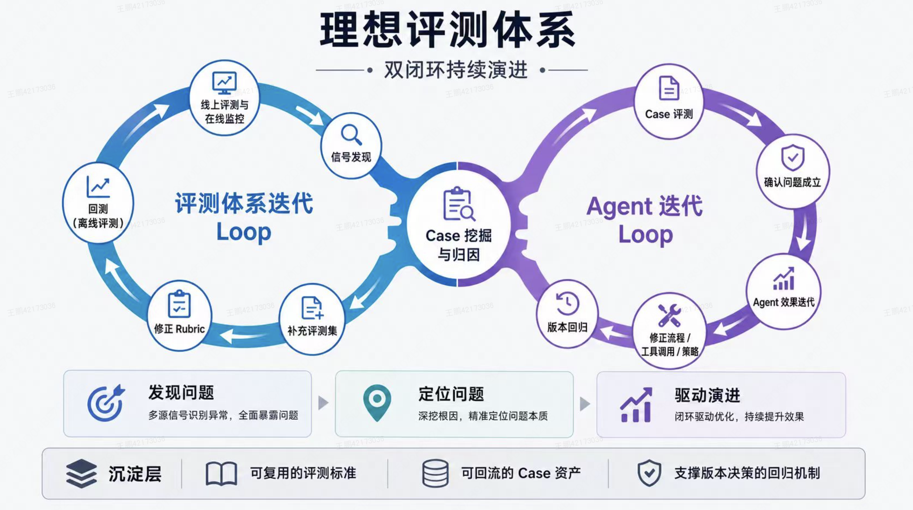
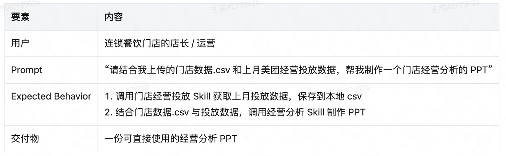
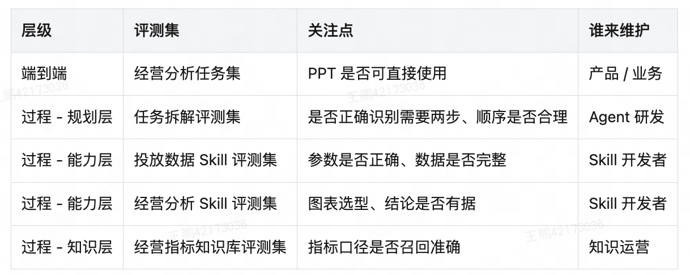
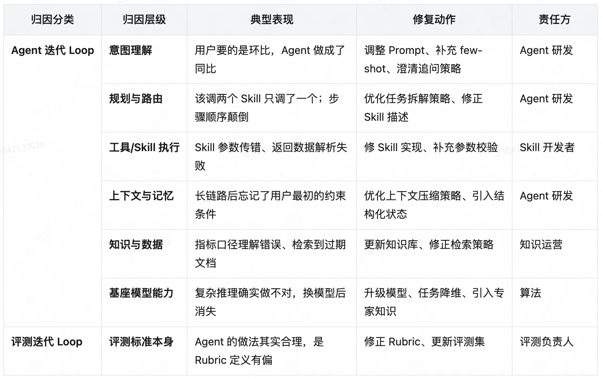
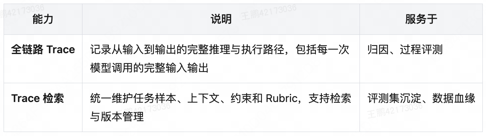
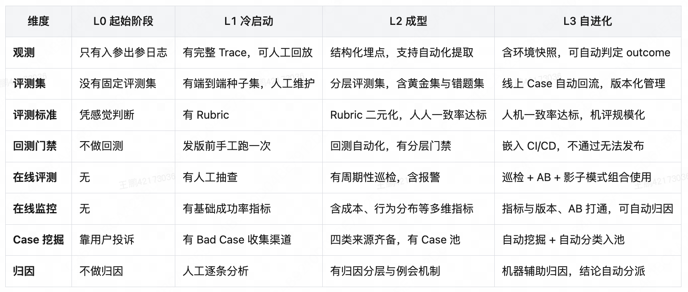

# 《Agent 评测白皮书》系列 01：Agent 评测全览——详解学习笔记

> 原文：[美团技术团队《Agent 评测白皮书》系列01：Agent 评测全览](https://tech.meituan.com/2026/09/10/Agent-Evaluation-White-Paper-01.html)，发表于 2026-09-10。

## 综述与阅读地图

这篇文章把 Agent 评测组织为四个模块：离线评测、在线评测与监控、Case 挖掘与归因、观测基建。体系需要能够发现问题、定位问题和推动改进。线上案例驱动两条闭环：一条改进 Agent，另一条修订评价标准和样本；二者共享评测资产。[框架来源](https://tech.meituan.com/2026/09/10/Agent-Evaluation-White-Paper-01.html)

下面以一个**自行设计的订单对账 Agent**贯穿讲解：用户上传订单表和退款表，要求 Agent 生成指定月份的净收入报告。这个例子既有确定的数值计算，又有开放的文字说明，适合观察“会回答”和“能完成任务”之间的差别。

| 章节 | 学习时需要解决的问题 |
|---|---|
| 一、整体框架 | 为什么已经有分数，还可能无法判断该改什么？ |
| 二、离线评测 | 怎样把业务要求写成可重复执行的评测任务？ |
| 三、线上反馈 | 如何解释用户反馈、质量分数与运行指标之间的差异？ |
| 四、案例归因 | 怎样从一份错误报告找到有证据支持的修复点？ |
| 五、观测基础 | 为了回答上述问题，运行时要记录什么？ |
| 六、成熟度 | 当前最缺的能力是什么，应先补哪一项？ |
| 七、学习练习 | 能否独立完成一个从要求到评测结果的例子？ |
| 八、常见疑问 | 分数、业务价值、工具成功与任务成功怎样区分？ |

## 一、理解评测体系的整体结构

### 1.1 评价结果为什么需要可信

**补充理解：先区分“评得稳定”与“评得正确”。**

假设两名评审都给一份对账报告打了 90 分。这个一致结果并不能单独证明报告质量好：他们可能都只看了排版，没有检查退款是否被重复扣除。

评价标准至少要让团队回答三个问题：

1. **对象是什么？** 评的是一份报告、一次完整任务，还是某个计算步骤？
2. **证据在哪里？** 结论来自原始数据、执行记录、产物，还是评审的主观印象？
3. **规则是什么？** 什么条件满足时通过，不满足时如何判定？

例如，把“报告要专业”改成下面三个独立条件，就更容易检查：

| 模糊要求 | 可检查的条件 | 证据 |
|---|---|---|
| 数字准确 | 净收入等于订单收入减去按约定口径计入的退款 | 数据快照与独立计算结果 |
| 信息完整 | 明确列出月份、币种和退款处理口径 | 报告正文 |
| 文件可用 | 约定路径存在报告文件，文件可以打开 | 文件系统与解析结果 |

进一步思考：如果用户后来要求跨币种对账，原来只覆盖单币种的条件就不够了。此时，即使所有旧样本仍然通过，也不能据此证明新功能正确。

### 1.2 两条相互咬合的迭代闭环

下图直接使用原文的双闭环示意图：**同一份线上证据，可以同时触发 Agent 修复和评测修订。** 两条路径不是必须二选一。


**用对账例子走一遍：**

1. 用户发现报告把同一笔退款扣了两次。
2. 查看运行记录，发现工具接口返回了重复行，Agent 直接求和。
3. 在 Agent 中增加按退款流水号去重的处理。
4. 在评测中增加“接口返回重复退款”的任务，检查净收入和重复记录处理说明。
5. 重跑已有任务，观察去重修改是否误删不同流水号的合法退款。
6. 上线后继续观察同类报告，确认修复在实际输入上有效。

如果只做第 3 步，未来重构可能重新引入同一个错误。如果只增加评测而不修复，团队会反复得到失败结果。把修改和证据连接起来，才形成可持续的工作流程。

**另一种情况：评测错判。** 假设报告使用了“元”而参考文件使用“分”，两者数值等价，但评分器按字符串比较判错。此时应修订数值归一化规则，不能为了过评测强制所有报告照抄参考文件。

### 1.3 三种能力怎样落到交付物上

**补充学习表：用交付物判断能力是否真正存在。**

| 能力 | 对账例子 | 可以检查的交付物 |
|---|---|---|
| 发现问题 | 找到金额异常、任务失败或用户指出的差错 | 案例编号、触发条件、相关任务 |
| 定位问题 | 确认重复扣款发生在读取、合并还是计算阶段 | 证据位置、根因说明、复现条件 |
| 推动改进 | 修复去重逻辑，并防止今后再次发生 | 修改记录、回归任务、前后结果 |

“系统自动生成了一个问题标签”只完成了中间一小步。如果标签没有证据、没有负责人、没有处理结果，它还不足以支撑迭代。

### 1.4 四个模块怎样配合

这里纠正旧版笔记的归类：**在线评测与在线监控归为一个模块，观测基建本身是第四个模块。**

下面的“例子”和“输出”是本笔记的补充设计。

| 模块 | 对账 Agent 中的例子 | 输出给谁 |
|---|---|---|
| 离线评测 | 对同一份数据快照比较新旧版本的金额与报告 | 给发布流程提供依据 |
| 在线评测与监控 | 检查真实报告的质量、错误率、耗时和任务类型 | 给案例分析提供候选信号 |
| Case 挖掘与归因 | 分析某次多扣退款的执行记录 | 给研发和评测维护者提供修改依据 |
| 观测基建 | 保存数据版本、工具参数、产物位置及评分记录 | 为其他模块提供证据 |

可以把模块关系理解成：执行留下记录，评测和监控读取记录，归因连接证据与修改，后续评测再检查修改是否有效。

### 1.5 原文场景与补充示例

下图为原文使用的商家经营分析 Agent 场景；本笔记另外使用订单对账作为补充练习。



对应到本笔记的对账练习，可以把执行过程概括为：确认月份与口径 → 读取数据 → 去重与关联 → 计算净收入 → 保存并交付报告。这个过程不要求 Agent 采用唯一实现；它可以使用 SQL，也可以用脚本完成计算。评测应约束必要的业务条件，例如不能重复扣款、不能混淆币种。

## 二、离线评测：把要求变成可运行的任务

### 2.1 评测集怎样组织

#### 2.1.1 一个 Task 需要哪些信息

**补充示例：下面是为学习设计的任务结构，不是某个框架的配置规范。**

```yaml
task:
  id: reconcile_sep_duplicate_refund
  description: "生成九月净收入报告，重复退款流水只能计入一次"

  input:
    request: "根据提供的文件，生成九月净收入报告"
    fixture: "orders_refunds_sep_v1"
    accounting_rule: "按交易发生日期计入当月，金额单位为人民币元"
    output_path: "output/september_report.md"

  environment:
    timezone: "Asia/Shanghai"
    reference_date: "2026-10-01"
    tools: ["read_table", "write_report"]
    reset_before_trial: true

  expected:
    gross_revenue: 1000
    unique_refund_total: 150
    net_revenue: 850
    file_exists: true

  checks:
    - id: net_amount
      method: deterministic
      criterion: "净收入为 850 元"
      required: true
    - id: duplicate_handling
      method: deterministic
      criterion: "同一退款流水号仅计入一次"
      required: true
    - id: explanation
      method: human_or_model
      criterion: "说明退款去重口径，并能指向输入数据"
      required: false
```

这里故意写出了时间、数据版本、单位和初始状态。缺少这些信息，同一个用户请求可能对应不同的正确答案。

还要区分三个对象：Task 是问题及其成功条件；Trial 是对该问题的一次执行；评分器负责根据执行证据给出判断。Agent 说“文件已生成”只是回答内容，真正的交付还要检查文件是否存在。这组术语可对照 [Anthropic 的评测术语说明](https://www.anthropic.com/engineering/demystifying-evals-for-ai-agents)。

**补充例子：为什么不能只给参考答案？**

预期净收入虽然是 850 元，但碰巧算出 850 并不能说明全过程正确。例如，多扣了一笔退款，又多算了一笔同额订单，错误可能互相抵消。针对这类风险，可以同时检查净额与关键中间量，而不只检查最后一个数字。

##### 补充：Metric、Rubric 和评分器各做什么

用同一个任务理解三者：

| 概念 | 本笔记中的具体例子 | 解决的问题 |
|---|---|---|
| Rubric / 检查规则 | “同一退款流水号只能计入一次” | 单个任务满足什么条件才合格 |
| Grader / 评分器 | 程序比较退款集合；人工或模型检查说明文字 | 由谁、根据哪些证据执行检查 |
| Metric / 汇总指标 | 合格任务数占全部有效评测任务的比例 | 一批任务或一个版本总体怎样 |

假设 20 个有效任务中有 17 个通过，则本次样本上的任务通过率是 85%。这个数字应同时保留“20 个任务”的分母，不能只展示 85%。

写 Rubric 时，尽量让每条只对应一个判断。以下规则包含三个要求，不利于失败定位：

> 金额正确、说明充分、文件格式清晰。

可以拆成金额、口径说明、文件可读性三个检查项。拆分后，团队能直接看到失败集中在哪一类。

#### 2.1.2 端到端评测与过程评测

**补充对照：同一个失败，可以从结果和步骤两个层面观察。**

| 对比项 | 端到端 | 过程 |
|---|---|---|
| 示例对象 | 用户是否拿到了正确、可读的净收入报告 | 去重、月份筛选、金额计算、文件写入 |
| 常见证据 | 报告文件、最终数值、用户要求 | 中间表、工具参数、阶段产物 |
| 适合回答 | 本次任务能否交付 | 哪个环节首先偏离预期 |
| 单独使用的不足 | 失败后可能难以定位 | 步骤通过不一定保证整体交付 |

例如，每一步计算都正确，但最后把报告写进了另一个用户的目录，过程计算指标可能全部通过，端到端任务仍然失败。

反过来，最终报告错误也不能直接推断模型计算能力不足。问题可能发生在读取了错误月份的数据，或工具输出被截断。

#### 2.1.3 评测集的分层示意

下图为原文的分层表，使用商家经营分析场景，展示不同层级的评测集、关注点和维护方。



可以先为“月度对账”建立端到端任务。若失败记录反复显示退款关联存在问题，再单独构建关联步骤的评测，用更小的输入更快定位。

**补充区分：任务范围与样本用途是两个维度。**

| 标签 | 本笔记中的用法 |
|---|---|
| 黄金样本 | 经过确认的高质量参考报告，帮助解释期望质量 |
| 历史错题 | 曾因重复退款失败的任务 |
| 挑战样本 | 涉及跨月退款与缺失字段的复杂任务 |
| 必过任务 | 发布时明确要求通过的核心对账任务 |

一个历史错题可以同时属于“过程评测”和“必过任务”。黄金样本也不意味着必须复制其全部措辞：数值和关键要求可以固定，合理表达通常允许变化。

### 2.2 一次回测应该怎样执行和解读

#### 2.2.1 控制哪些变量

**补充执行记录模板：**

| 项目 | 需要记录的内容 | 否则可能出现的误判 |
|---|---|---|
| Agent 版本 | 代码、Prompt、模型标识、工具定义 | 无法知道到底改了什么 |
| 数据版本 | 数据快照与文件标识 | 数据变化被误认为能力变化 |
| 标准版本 | 检查规则和评分器版本 | 评分变严被误认为 Agent 退化 |
| 初始环境 | 可见文件、工具权限、模拟日期 | 残留文件让第二次运行更容易 |
| 执行结果 | 每次 Trial 的状态、证据和耗时 | 平均分掩盖偶发失败 |

例如，旧版本运行时目录为空，新版本运行时却能读取旧版已生成的报告，这就不是公平的版本对比。每次运行需要明确哪些状态应恢复到初始值。

#### 2.2.2 多次执行与三种成功指标

**术语补充：Pass Rate、pass@k、pass^k 不能直接互换。** pass@k 关注 k 次中至少一次成功；pass^k 关注 k 次全部成功。可参照 [Anthropic 对非确定性评测的解释](https://www.anthropic.com/engineering/demystifying-evals-for-ai-agents)。

| 名称 | 含义 | 适用的理解角度 |
|---|---|---|
| 经验通过率（Pass Rate） | 观测到的成功次数除以有效执行次数 | 这一批执行实际有多少次成功 |
| pass@k | k 次尝试中至少成功一次的概率 | 是否允许尝试多个候选并挑出成功结果 |
| pass^k | k 次尝试都成功的概率 | 多次执行的一致性要求 |

**自行推导的数值例子：** 假设每次独立执行的成功概率恒为 0.8，尝试三次：

- 至少一次成功的概率为 `1 - (1 - 0.8)^3 = 99.2%`。
- 三次都成功的概率为 `0.8^3 = 51.2%`。

这两个结论可以同时成立，因此“多试几次总能成功”不能直接说明系统稳定。以上公式依赖独立且同分布的简化假设，不能在存在共享故障或状态污染时直接套用，也不是对任意 benchmark 的完整估计公式。

报告结果时还要写清是否允许重试、重试次数及总成本。对账任务如果需要用户人工确认哪一份报告正确，重试本身就包含额外负担。

#### 2.2.3 门禁如何避免被总分掩盖

**补充方案，以下不是通用阈值：**

| 检查项 | 示例发布规则 | 理由 |
|---|---|---|
| 核心金额正确 | 指定必过任务中不允许错误 | 用户依据该金额做决策 |
| 输出目录正确 | 指定任务必须交付到目标路径 | 文件放错位置等于无法交付 |
| 说明文字易读 | 在明确评分口径下达到项目约定阈值 | 允许存在表达方式差异 |
| 执行耗时 | 与约定预算比较，并记录长尾 | 平均耗时可能掩盖极慢任务 |

如果金额错了，排版再好也不应该通过加权平均“补回来”。同时，评测基础设施故障应单独标识：评分器崩溃意味着本次没有得到有效判断，不能自动算成通过。

#### 2.2.4 怎样理解离线与线上不一致

下面是补充排查顺序：

1. 核对线上线下拿到的输入是否一致。
2. 核对外部工具版本、权限和返回数据。
3. 核对是否有历史记忆、缓存或残留产物。
4. 核对评价标准是否相同。
5. 排除这些差异后，再讨论模型波动或场景覆盖不足。

离线分数对应的是“这批任务、这个环境、这套标准下”的表现。报告中把这些条件写清楚，分数才有解释空间。

## 三、在线评测与监控：解释真实使用中的变化

### 3.1 三种线上观察方式的补充例子

以下表格围绕对账 Agent 展开，不是原图内容的复刻。

| 方式 | 如何用于本例 | 能观察什么 | 需要留意什么 |
|---|---|---|---|
| 影子模式 | 把请求副本交给候选版本，在隔离目录生成报告供比较 | 新版本在真实输入上的行为 | 不能让副本重复触发真实写入等副作用 |
| A/B 实验 | 在适用条件下，把用户或任务分到不同版本 | 实际使用结果是否发生变化 | 分组、观察窗口和任务构成必须可比较 |
| 周期巡检 | 定期运行已知输入的对账任务 | 核心依赖和任务行为是否持续可用 | 固定任务的成功不能代表全部真实请求 |

**补充理解：影子模式的结果与用户体验之间仍有距离。** 候选版本即使输出了更好的报告，也未必证明用户能更快完成工作，因为影子执行通常没有经历真实交互与后续使用。

### 3.2 巡检怎样同时产出分数和可分析的案例

**补充巡检设计：**

```text
巡检任务：使用固定订单数据生成当月净收入报告
检查内容：净额、退款去重、报告存在性、运行耗时
记录内容：任务编号、Agent 版本、运行时间、Trace ID、失败检查项
异常处理：保留数据与产物，创建可追踪案例，安排归因
```

如果只发一条“失败了”的通知，而没有保存当时的数据和版本，第二天工具恢复后可能无法复现问题。

还要记录失败是否来自业务判断、工具超时或评分程序异常。三者可能同时让巡检变红，但处理方式不同。

### 3.3 运行指标怎样与质量结果一起看

**补充观察表：**

| 指标类别 | 对账例子 | 容易误读的地方 |
|---|---|---|
| 可用性 | 文件读取失败率、工具超时率 | 接口返回成功并不代表内容正确 |
| 时延 | 完成报告耗时、中位数与高分位耗时 | 平均值不能描述全部用户体验 |
| 资源消耗 | 每任务调用次数与 Token 消耗 | 成本下降可能来自任务提前失败 |
| 任务构成 | 普通对账与跨币种对账的比例 | 总体成功率变化可能受任务组合影响 |
| 产物质量 | 净额正确率、报告可交付率 | 需要可靠的数据核验和判定标准 |

**自行计算的分布变化例子：**

假设普通任务成功率一直为 95%，复杂任务一直为 60%。

| 时间 | 普通任务占比 | 复杂任务占比 | 总体成功率 |
|---|---:|---:|---:|
| 第一周 | 90% | 10% | 91.5% |
| 第二周 | 50% | 50% | 77.5% |

这里两个子场景的能力都没有变化，总体分数仍下降了 14 个百分点。由此可见，分析线上变化时应同时检查分场景结果和流量构成，不能只盯一个总分。

## 四、Case 挖掘与归因：把现象变成证据

### 4.1 从不同入口寻找案例

**补充采集方案：**

| 入口 | 对账例子 | 样本偏差 |
|---|---|---|
| 用户反馈 | 用户指出少算了一笔订单 | 只看得到用户发现且愿意反馈的问题 |
| 指标筛查 | 运行耗时明显增加的任务 | 未必能直接发现静默的数据错误 |
| 条件筛选 | 包含重复流水号或混合币种的数据 | 只能覆盖事先设计的筛选条件 |
| 随机抽样 | 从全部任务中随机抽取人工核查 | 在低错误率场景下需要更多检查成本 |

筛出的样本是“值得看”，不等于已经证实存在错误。例如耗时变长可能只是用户上传了更大的数据文件。

补充实践上可以保存采集入口，防止把专门筛选的高风险样本误当作全部线上任务的代表，再据此计算总体错误率。

### 4.2 好案例、坏案例和暂时无法判断的案例

**补充案例卡片：**

```yaml
case:
  id: case_0042
  source: user_feedback
  task_id: reconcile_sep_duplicate_refund
  trace_id: trace_0042
  agent_version: reconcile_v3
  observed: "净收入输出为 700 元"
  expected: "在本任务约定口径下应为 850 元"
  evidence: "同一退款流水号出现两次，各 150 元"
  judgement: confirmed_failure
  root_cause: "聚合前未按退款流水号去重"
  follow_up:
    - "修改数据聚合逻辑"
    - "增加重复流水号任务"
    - "重跑合法多笔退款任务"
```

“坏案例”也需要明确依据。若缺少原始订单数据，暂时无法核对金额，合适的状态是待确认，并注明缺少的证据，而不是凭用户一句话或模型一句话确定根因。

好的案例则可以帮助解释质量要求：例如一份正确报告怎样陈述口径、如何呈现异常记录。参考它的目的应是提炼可检查的要求，避免把某种措辞固定为唯一标准答案。

### 4.3 归因：追查第一个偏离事实的环节

下图为原文的归因分层表，可同时对照问题层级、典型表现、修复动作和责任方。后面的表格仍是针对对账任务补充的排查示例。



**补充归因表：**

| 看到的现象 | 可以检查的证据 | 暂时不能直接下的结论 |
|---|---|---|
| 月份错了 | 用户请求、解析后的时间范围、工具参数 | “模型算术不行” |
| 金额少了 | 原始行数、筛选结果、退款集合、聚合结果 | “换模型就能解决” |
| 工具报错 | 参数、权限、响应、超时与重试记录 | “工具一定不稳定” |
| 文件不存在 | 写入结果、目标路径、最终状态 | “回答提到生成就算完成” |
| 人评和机评分歧 | 判定条件、证据片段、评分输出 | “机评或人评一定正确” |

根因说明最好能导出可检验的修改。例如“模型不够聪明”很难验证，而“字段别名导致解析器把退款时间当成订单时间”可以通过修改映射与针对性任务检查。

若修复后目标样本通过，还需要观察相邻情况。例如为重复退款添加去重后，应检查不同流水号、相同金额的两笔合法退款是否仍能同时计入。

## 五、观测基建：保存足以解释执行的证据

### 5.1 从问题反推需要记录的数据

先看原文的观测能力图，再对照后面针对对账任务设计的字段表。



| 层次 | 建议记录的证据 | 对应的排查问题 |
|---|---|---|
| 请求 | 请求 ID、任务类型、约定口径 | 用户到底要算哪个月份？ |
| 版本 | 模型、代码、Prompt 与工具定义的版本 | 哪个变化可能影响了结果？ |
| 可见上下文 | 实际发给模型的输入、检索结果与数据引用 | 决策时是否拿到了正确数据？ |
| 工具 | 名称、参数、返回内容或快照引用、状态 | 参数错了，还是返回结果有问题？ |
| 阶段产物 | 去重后的表、聚合结果、报告路径 | 第一次偏差出现在什么时候？ |
| 评分 | Rubric 版本、判定、证据位置 | 分数变化来自哪里？ |
| 执行资源 | 起止时间、Token、重试次数 | 质量改进付出了多少运行成本？ |

这里的 Trace 指实际可获得的执行事件和输入输出，不意味着能够取得模型未公开的内部思维过程。对于敏感数据，应按访问和保留要求处理；调试所需的证据可以是受控快照引用，不必把所有原始数据复制到普通日志中。

### 5.2 一条简化执行记录的阅读方式

**补充示意：以下缩进表示调用或阶段关系。**

```text
任务 task_0042 / Agent reconcile_v3
├─ 解析请求
│  └─ month=2026-09, currency=CNY
├─ 读取订单
│  └─ snapshot=orders_sep_v1, amount=1000
├─ 读取退款
│  └─ rows=2, refund_ids=[R01, R01], amounts=[150, 150]
├─ 聚合
│  └─ refund_total=300, net_revenue=700
├─ 写入报告
│  └─ output/september_report.md
└─ 评测
   └─ net_amount=fail, expected=850, observed=700
```

这条记录让我们看到，错误在生成报告之前已经发生。下一步应检查退款聚合规则，而不是先修改报告写作 Prompt。

如果记录只保留最终一句“报告已生成”，上述判断就无法完成。观测是否够用，可以通过一个实际失败案例检验：能否沿证据追到首次偏差，并找到足够的信息重现它。

## 六、成熟度自查：用具体证据判断短板

### 6.1 三种常见的建设失衡——补充例子

| 假设团队现状 | 对账项目中的表现 | 可以优先补什么 |
|---|---|---|
| 能出离线分数，缺少真实反馈 | 固定表格全通过，遇到用户的新字段就失败 | 新输入采样与任务分类 |
| 有运行日志，质量标准模糊 | 工具没有报错，却不知道报告金额是否可信 | 明确的数值核验与交付条件 |
| 两端都有数据，缺少问题处理链路 | 用户问题留在工单里，下一版仍犯同样的错 | 案例到修改、回归任务的关联 |

不要只用“是否购买或部署了某个平台”判断成熟度。平台存在并不意味着数据正确、规则可靠、问题有人处理。

### 6.2 可直接填写的自查表

先保留原文的 L0—L3 成熟度矩阵，方便按维度对照。



**下方可填写的自查表是本笔记的补充设计，与上面的原文矩阵区分使用。**

填写时应尽量写下一个实际文件、记录或案例，不能只勾选“已建设”。

| 自查问题 | 可以提交的证据 | 当前状态 |
|---|---|---|
| 能明确区分成功、失败和无法判断吗？ | 一份具体任务及判定规则 | 待填写 |
| 能重跑同一任务吗？ | 数据快照、环境说明、任务入口 | 待填写 |
| 新旧版本能公平比较吗？ | 版本和标准均有记录的结果表 | 待填写 |
| 能定位一份错误报告的首次偏差吗？ | 有完整证据链的案例 | 待填写 |
| 线上新需求能进入评测吗？ | 最近一次新增场景记录 | 待填写 |
| 修复过的问题能防止再次出现吗？ | 关联修复记录的回归任务 | 待填写 |
| 能发现评分器自身的问题吗？ | 人工复核与评分修订记录 | 待填写 |
| 分数和实际使用效果能一起解释吗？ | 质量结果、任务构成与使用反馈 | 待填写 |

### 6.3 一种渐进落地顺序——补充建议

1. **先跑通一条任务。** 明确输入、成功条件和证据位置，让别人能够复核。
2. **再覆盖不同情况。** 为正常输入、重复数据、缺失字段各增加任务，避免只测顺利路径。
3. **接入版本比较。** 保存旧版结果，在同样条件下比较候选版本。
4. **建立案例回流。** 选一个真实失败，完成归因、修复和回归任务添加。
5. **按实际负担自动化。** 当重复运行、采样或人工判定成为瓶颈时，再针对瓶颈建设。

这里不设统一的样本数量或成熟度达标阈值。对账金额的风险、任务多样性和维护资源不同，合理投入也会不同。

## 七、把概念串成一次学习练习

### 7.1 从要求到回归任务的完整练习

**练习素材：**

```text
订单：
O01，2026-09-03，600 元
O02，2026-09-12，400 元

退款：
R01，对应 O01，2026-09-20，150 元
R01，对应 O01，2026-09-20，150 元（接口重复返回）

用户要求：
生成九月净收入报告。重复退款流水只计一次，并说明统计口径。
```

可以自己完成下面五步：

1. 写出预期结果和两条关键 Rubric。
2. 设计一种会产生错误结果的处理方式。
3. 指出定位这个错误需要哪些记录。
4. 说明应该修改 Agent、评分器，还是同时修改两者。
5. 再添加一个“不能误删合法退款”的相邻任务。

**参考思路：** 预期净收入为 850 元。关键规则包括按流水号去重和最终金额正确。若实际输出 700 元，先检查去重前后的退款集合。相邻任务可使用两个不同流水号、各 150 元的退款，此时净收入应为 700 元。

### 7.2 读完应能解释的概念关系

- Task 定义问题，Trial 产生一次执行，评分器根据证据判定，Metric 汇总结果。
- 端到端结果与过程证据相互补充，但过程检查不应把合理实现锁死在一条路径上。
- 版本变化、数据变化和评分变化都可能改变分数，需要分别记录。
- 错误案例既可以暴露 Agent 缺陷，也可以暴露判定规则缺陷。
- 有分数、有日志，还需要把失败和实际修改关联起来，才能观察问题是否真正解决。

## 八、FAQ 与容易混淆的概念

### 8.1 离线分数更高，就一定值得发布吗？

**补充推理：** 假设新版对账任务通过率提高，但每次耗时从几十秒增加到几十分钟，用户实际完成工作可能更慢。发布决策需要同时考虑质量、时延、成本和适用范围。

还要看提高发生在哪里：核心任务退化而大量简单任务略有提升时，总分可能变高。按任务类别、重要条件和资源预算拆开观察，会比只比较一个平均值更有帮助。

### 8.2 离线分数不变，是否说明改动没有价值？

不一定。例如新版本保持金额正确率不变，同时缩短了一半耗时，这可能有实际价值。又例如新增了跨币种功能，旧评测集只有人民币任务，分数不变只是说明旧任务上没有观察到变化。

对应的处理是检查“当前指标是否能够表达这次改动的目标”，并为新能力定义相应任务。

### 8.3 工具调用成功、过程正确和任务成功有什么区别？

| 层次 | 对账例子 |
|---|---|
| 调用成功 | 读取表格工具返回正常状态 |
| 过程正确 | 读取了正确月份的数据，并按流水号正确去重 |
| 任务成功 | 用户收到数值正确、口径清楚、位置正确且可打开的报告 |

三个层次逐步增加约束。仅有第一层的成功记录，不能推出后两层。

### 8.4 多次运行成功过一次，算稳定吗？

这需要看产品允许怎样使用结果。若用户可以低成本选择多个候选，至少一次成功可能有价值；若 Agent 自动交付对账结果，每次是否可靠更重要。记录重试预算，并选择与产品使用方式一致的指标，才能避免误解。

### 8.5 评分器判失败时，应该先做什么？

先查看失败依据。核对任务是否明确、输入是否可用、评分器是否拿到了需要的证据，然后追查执行过程。若报告金额与单位换算正确，却被字符串比较误判，应先修正评分方式。

### 8.6 本文和原文图表如何对照？

原文图片已嵌入对应章节：1.2 双闭环、1.5 商家经营分析场景、2.1.3 评测集分层、4.3 归因分层、5.1 观测能力、6.2 成熟度矩阵。图片使用仓库内的相对路径，不依赖 Mermaid 渲染。放大阅读时可直接打开对应 PNG；每张图的来源记录在 [图片说明](assets/agent-evaluation-01/README.md) 中。对账案例和可填写自查表仍属于补充练习。
